# Results — I-94 hourly traffic forecasting (24 hours ahead)
_Generated 2026-11-23 05:44 from the artifacts in `outputs/`._

## Key numbers (test set, Jan–Sep 2018)
- **Best model (selected on validation): DL-TCN** — MAE 223.1 veh/h, RMSE 371.8, sMAPE 9.59%, R² 0.9646, rMAE 0.657
- vs Seasonal-naive (weekly) (MAE 339.7): 34.3% lower MAE
- vs Ridge (linear, lags) (MAE 258.9): 13.8% lower MAE
- Ablation without weather: MAE 214.0 → removing weather *lowers* the error by 9.1 veh/h (past weather adds noise rather than signal)
- Most important feature groups (permutation): Future calendar (hour/day/season), Traffic history, Past calendar (hour/day/season)

## Leaderboard

| model | MAE | RMSE | sMAPE (%) | R² | rMAE |
|---|---|---|---|---|---|
| Ablation: DL-TCN without weather | 214.0 | 358.1 | 9.32 | 0.9671 | 0.630 |
| DL-TCN | 223.1 | 371.8 | 9.59 | 0.9646 | 0.657 |
| DL-GRU (tuned) | 248.3 | 401.0 | 10.82 | 0.9588 | 0.731 |
| Ridge (linear, lags) | 258.9 | 410.3 | 13.13 | 0.9569 | 0.762 |
| DL-GRU | 260.9 | 410.8 | 11.36 | 0.9567 | 0.768 |
| DL-MLP | 266.4 | 432.7 | 11.29 | 0.9520 | 0.784 |
| DL-PatchTransformer | 266.7 | 421.8 | 12.66 | 0.9544 | 0.785 |
| DL-LSTM | 279.7 | 452.8 | 11.83 | 0.9475 | 0.823 |
| Seasonal-naive (weekly) | 339.7 | 651.7 | 12.43 | 0.8912 | 1.000 |
| Daily-naive | 564.7 | 1030.5 | 21.61 | 0.7278 | 1.662 |

## Figures

### Leaderboard
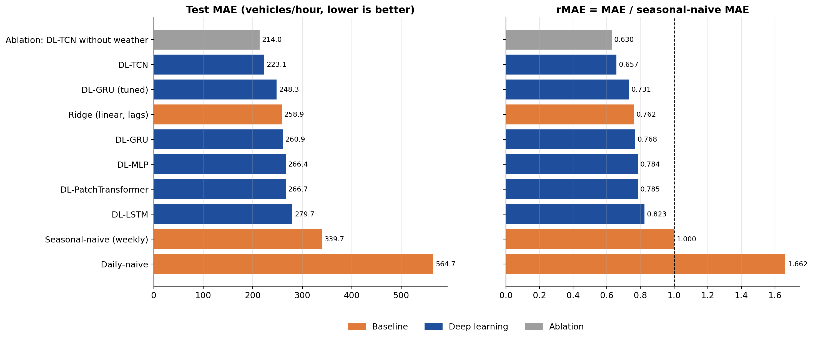

### Mae by horizon
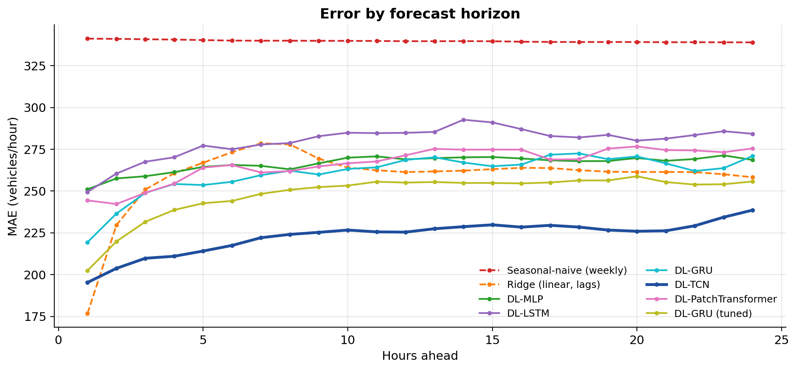

### Weekday hour heatmap
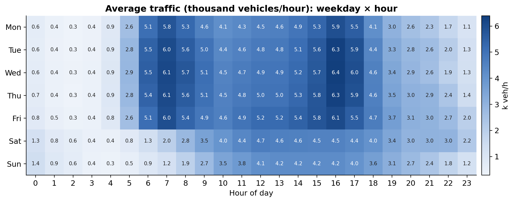

### Day type profile
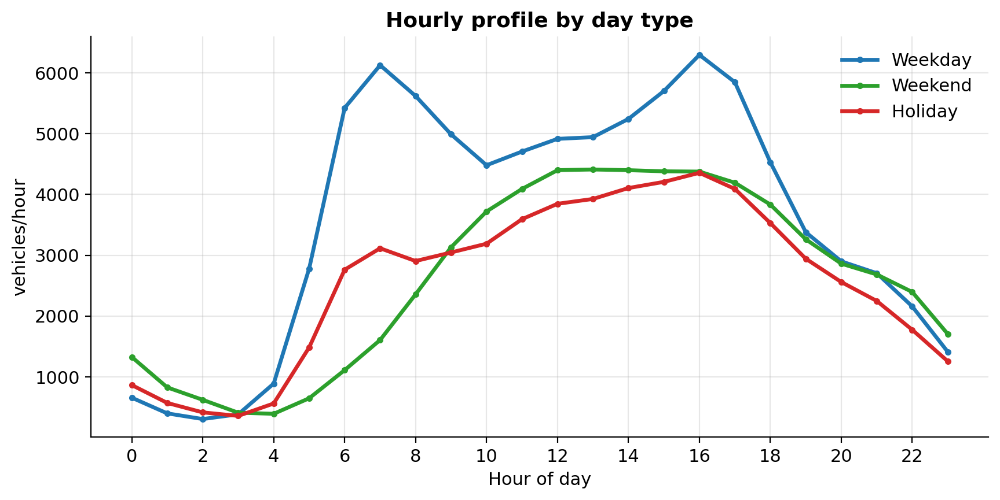

### Forecast examples
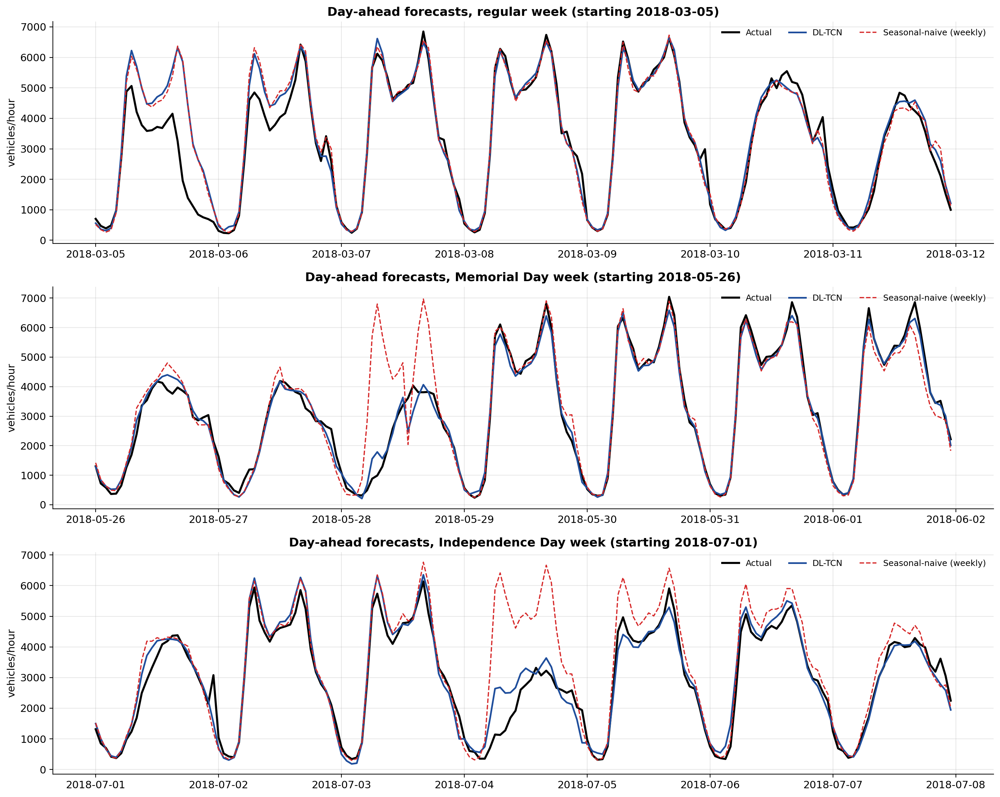

### Error breakdown
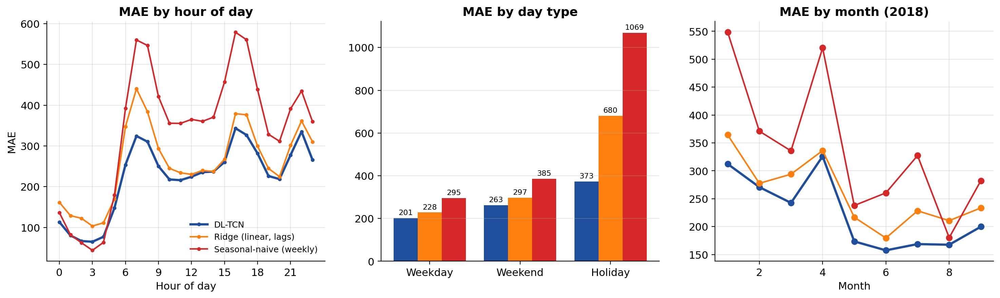

### Pred vs actual
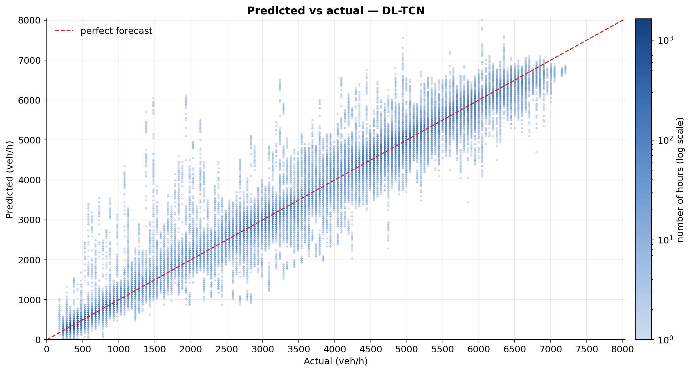

### Residuals
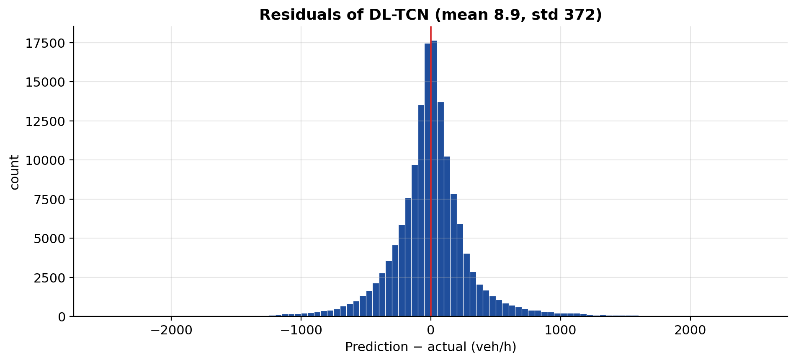

### Permutation importance
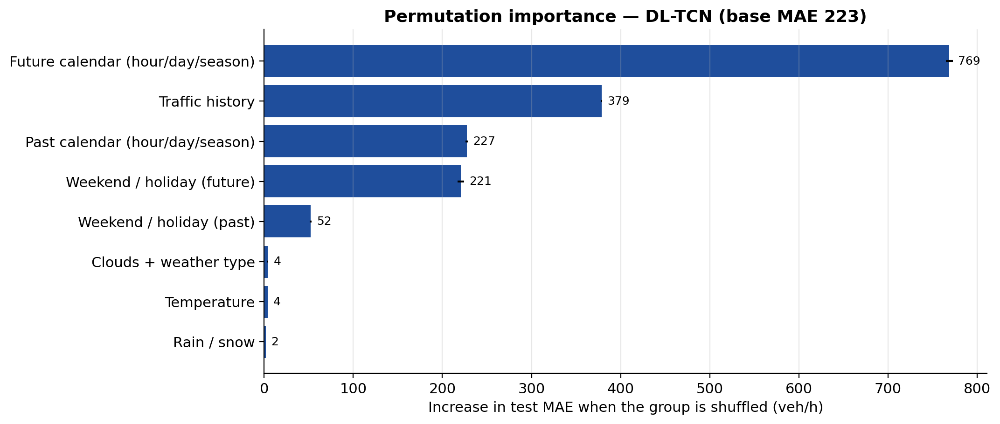

### Ig by lag
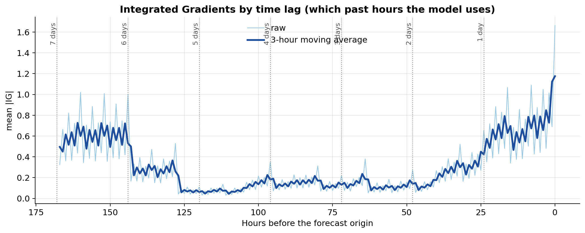

### Ig by feature
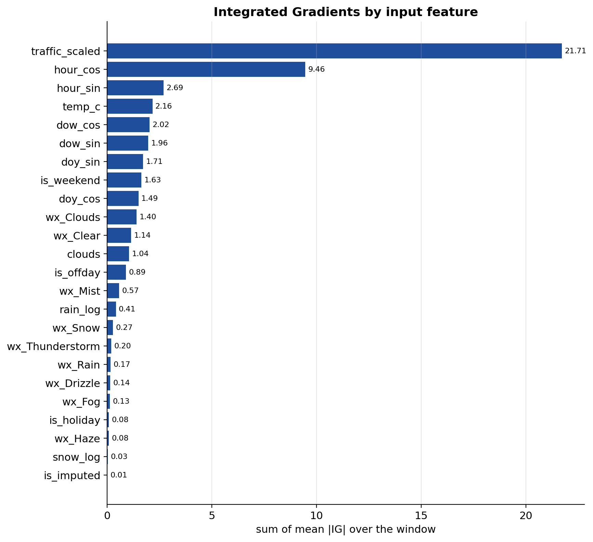

### Ig horizon heatmap
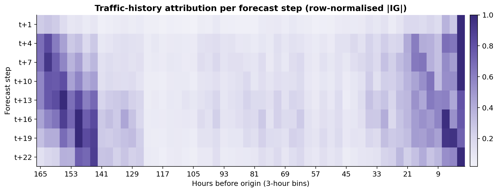

### Learning curves
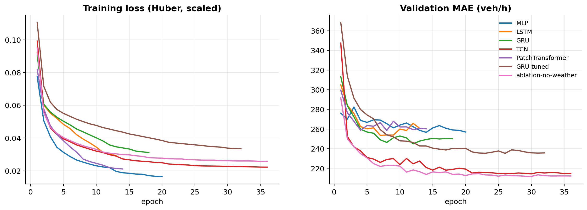

### Tuning trials
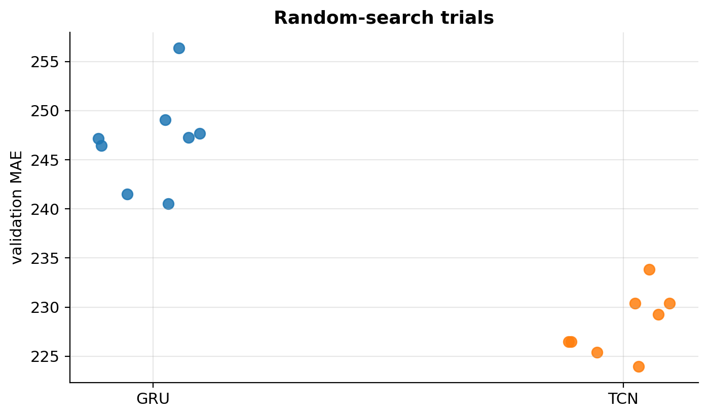

## Tables

- `tables/leaderboard_test.csv`
- `tables/mae_by_horizon.csv`
- `tables/mae_by_hour.csv`
- `tables/mae_by_day_type.csv`
- `tables/mae_by_month.csv`
- `tables/worst_days_best_model.csv`
- `tables/permutation_importance.csv`
- `tables/ig_feature_importance.csv`
- `tables/tuning_log.csv`
- `tables/data_splits.csv`

## Selected configuration
```json
{
  "key": "TCN",
  "name": "DL-TCN",
  "val_MAE": 214.3956656711328,
  "spec": {
    "kind": "TCN",
    "hp": {
      "channels": 64,
      "kernel": 3,
      "dropout": 0.1
    },
    "lr": 0.001,
    "wd": 0.0001,
    "batch_size": 256,
    "head_hidden": 256
  }
}
```
